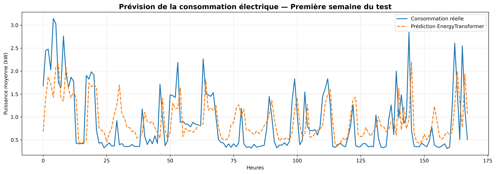
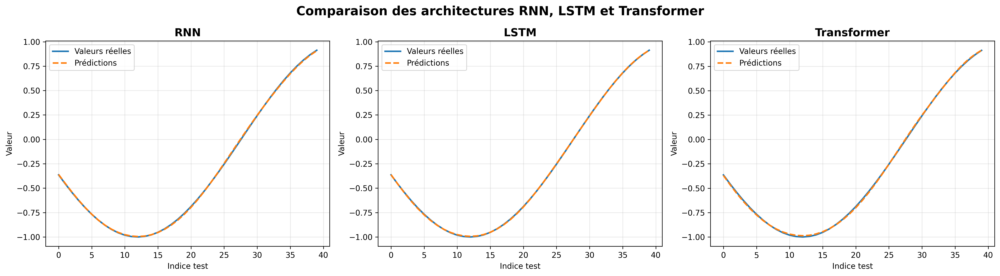

# TP4 — Architecture Transformer

<p align="center">
  <strong>Étude et implémentation des architectures séquentielles avec PyTorch</strong>
</p>

<p align="center">
  
  
  
  
</p>

## Présentation du projet

Ce projet pratique porte sur l'étude et l'implémentation des architectures Transformer et de leurs applications au traitement des séquences.

Réalisé avec **Python et PyTorch**, il explore plusieurs approches de modélisation séquentielle, depuis les réseaux récurrents classiques jusqu'aux architectures modernes basées sur l'attention.

Le travail est organisé en deux parties :

- Une étude comparative des architectures RNN, LSTM et Transformer sur une série temporelle sinusoïdale, accompagnée d'une exploration de GPT-2 et BERT préentraînés.
- Trois exercices pratiques consacrés à la prévision de la consommation électrique, à la génération de texte avec Mini-GPT et à la prédiction de mots masqués avec Mini-BERT.

## Objectifs pédagogiques

- Comprendre le fonctionnement des architectures RNN, LSTM et Transformer.
- Étudier le mécanisme d'attention et son rôle dans le traitement des séquences.
- Comprendre la différence entre génération autorégressive et modélisation bidirectionnelle.
- Implémenter et entraîner des modèles Transformer avec PyTorch.
- Évaluer les performances des modèles à l'aide de métriques adaptées.
- Expérimenter les mécanismes de génération de texte et de Masked Language Modeling.

## Technologies utilisées

| Technologie | Utilisation |
|---|---|
| Python | Langage principal |
| PyTorch | Construction et entraînement des modèles |
| NumPy | Manipulation numérique |
| Pandas | Préparation des données |
| Matplotlib | Visualisation des résultats |
| Scikit-learn | Outils de traitement et d'évaluation |
| Hugging Face Transformers | Utilisation de GPT-2 et BERT préentraînés |
| Jupyter Notebook | Environnement expérimental |

## Organisation du travail

### 1. Étude des architectures séquentielles

Une série temporelle sinusoïdale est utilisée pour comparer trois architectures :

- **RNN** : traitement récurrent des séquences.
- **LSTM** : gestion des dépendances temporelles grâce à des mécanismes de portes.
- **Mini-Transformer** : exploitation du mécanisme d'attention.

Cette partie comprend également deux expérimentations avec des modèles préentraînés :

- GPT-2 pour la génération autorégressive de texte.
- BERT pour la prédiction d'un mot masqué à partir de son contexte bidirectionnel.

### 2. Exercice 1 — Prévision de la consommation électrique

**Objectif :** prédire la consommation électrique de l'heure suivante à partir des 24 dernières heures.

Le modèle EnergyTransformer est entraîné sur le jeu de données Household Power Consumption.

Principales étapes :
- Préparation et agrégation horaire des données.
- Normalisation à partir des données d'entraînement.
- Construction de séquences temporelles de 24 heures.
- Entraînement et validation du Transformer.
- Comparaison avec deux méthodes de référence : Persistence et référence à 24 heures.

**Résultats obtenus sur le jeu de test :**

| Modèle | MAE (kW) | RMSE (kW) |
|---|---:|---:|
| EnergyTransformer | **0.3541** | **0.4918** |
| Persistence | 0.3892 | 0.5884 |
| Référence 24 heures | 0.5133 | 0.7639 |

Le modèle EnergyTransformer obtient les meilleures performances parmi les trois méthodes évaluées.



### 3. Exercice 2 — Mini-GPT : génération de texte

**Objectif :** construire un modèle autorégressif capable de générer du texte caractère par caractère.

Le Mini-GPT est entraîné depuis zéro sur un petit corpus français.

Caractéristiques principales :
- Vocabulaire de 31 caractères.
- Longueur du contexte : 64.
- Deux blocs GPT.
- 1 000 étapes d'entraînement.
- Attention causale pour empêcher l'accès aux caractères futurs.

**Évolution de la loss :**

| Étape | Loss |
|---:|---:|
| 200 | 1.7199 |
| 400 | 0.8036 |
| 600 | 0.2325 |
| 800 | 0.1083 |
| 1000 | **0.0720** |

La génération est expérimentée avec trois températures : 0.5, 1.0 et 1.5 afin d'observer leur influence sur la diversité et la cohérence du texte.

### 4. Exercice 3 — Mini-BERT : prédiction de mots masqués

**Objectif :** implémenter un modèle bidirectionnel capable de retrouver des mots masqués dans une phrase.

Le Mini-BERT utilise un petit corpus français et apprend à reconstruire les tokens sélectionnés à partir du contexte.

Caractéristiques principales :
- Vocabulaire de 51 mots.
- Deux couches Transformer.
- Quatre têtes d'attention.
- 30 époques d'entraînement.
- Fonction de perte calculée sur les positions sélectionnées.

**Évolution de la loss :**

| Époque | Loss |
|---:|---:|
| 5 | 1.4628 |
| 10 | 0.4228 |
| 15 | 0.1510 |
| 20 | 0.0829 |
| 25 | 0.0597 |
| 30 | **0.0366** |

**Accuracy obtenue sur les tokens sélectionnés en validation : 100 %.**

> Limite expérimentale : le corpus est de petite taille et contient des phrases répétées. Ce résultat ne permet donc pas de conclure à une généralisation sur des phrases inédites.

## Visualisation des résultats

### Prévision de la consommation électrique


### Comparaison des architectures



### Convergence de Mini-GPT et Mini-BERT


## Structure du dépôt

```text
TP4-Transformer-Architecture/
│
├── TP4_Architecture_Transformer_Complet.ipynb
├── README.md
├── requirements.txt
├── .gitignore
│
├── data/
│   └── README.md
│
├── docs/
│   └── methodology.md
│
└── results/
    ├── plots/
    │   ├── sinusoidal_series.png
    │   ├── rnn_predictions.png
    │   ├── lstm_predictions.png
    │   ├── transformer_predictions.png
    │   ├── model_comparison.png
    │   └── energy_forecasting.png
    │
    └── screenshots/
        ├── 01_presentation.png
        ├── 02_model_comparison.png
        ├── 03_energy_forecasting.png
        ├── 04_mini_gpt.png
        ├── 05_mini_bert.png
        └── 06_training_results.png
```

## Installation et exécution

### 1. Cloner le dépôt

```bash
git clone https://github.com/flamekk/TP4-Transformer-Architecture.git
cd TP4-Transformer-Architecture
```

### 2. Créer un environnement virtuel

```bash
python -m venv transformer_env
```

Sous Windows :

```powershell
transformer_env\Scripts\activate
```

### 3. Installer les dépendances

```bash
python -m pip install --upgrade pip
pip install -r requirements.txt
```

### 4. Lancer Jupyter Notebook

```bash
jupyter notebook
```

Ouvrir ensuite le fichier :

`TP4_Architecture_Transformer_Complet.ipynb`

Exécuter les cellules dans l'ordre.

### 5. Télécharger les données

Pour l'exercice de prévision électrique, télécharger le jeu de données Household Power Consumption depuis le [UCI Machine Learning Repository](https://archive.ics.uci.edu/dataset/235/individual+household+electric+power+consumption).

Consulter `data/README.md` pour connaître l'organisation attendue des fichiers.

Les modèles GPT-2 et BERT préentraînés nécessitent un accès Internet lors de leur premier téléchargement depuis Hugging Face.

## Documentation complémentaire

- [Méthodologie expérimentale](docs/methodology.md)
- [Instructions relatives aux données](data/README.md)

## Limites et perspectives

Plusieurs pistes peuvent prolonger ce travail :

- Étudier l'effet d'une fenêtre temporelle de 168 heures.
- Ajouter des variables temporelles comme l'heure et le jour de la semaine.
- Tester des corpus textuels plus importants et plus diversifiés.
- Comparer différentes configurations des architectures Transformer.
- Évaluer les modèles sur des données indépendantes pour mieux mesurer leur généralisation.

## Conclusion

Ce TP permet d'explorer les principales architectures de traitement séquentiel et de mettre en pratique les mécanismes fondamentaux des Transformers.

À travers la prévision de séries temporelles, la génération autorégressive et la prédiction de mots masqués, ce travail illustre la polyvalence des architectures basées sur l'attention dans les domaines du Deep Learning et du NLP.