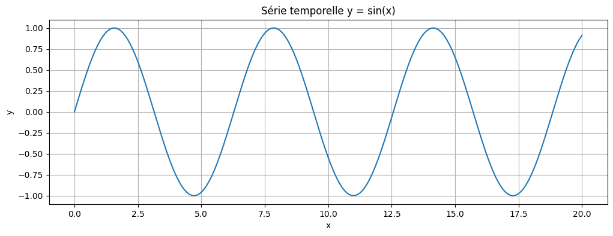
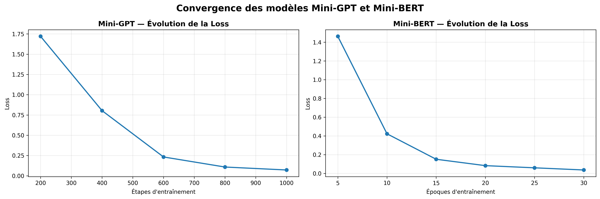

# TP4 — Architecture Transformer

<p align="center">
  <strong>Étude, implémentation et expérimentation des architectures séquentielles avec PyTorch</strong>
</p>

<p align="center">
  
  
  
  
  
</p>

---

## 1. Présentation du projet

Ce projet pratique porte sur l'étude et l'implémentation des architectures de réseaux de neurones dédiées au traitement des séquences, avec une attention particulière portée à l'architecture Transformer.

Réalisé avec **Python, PyTorch et Hugging Face Transformers**, ce TP explore les différences entre les réseaux récurrents classiques et les architectures basées sur le mécanisme d'attention.

Le travail est organisé en deux grandes parties :

- **Première partie :** étude comparative des architectures RNN, LSTM et Transformer sur une série temporelle synthétique, suivie d'expérimentations avec les modèles préentraînés GPT-2 et BERT.
- **Deuxième partie :** réalisation de trois exercices pratiques portant sur la prévision de consommation électrique, la génération de texte avec Mini-GPT et la prédiction de mots masqués avec Mini-BERT.

L'ensemble des expérimentations est regroupé dans un notebook Jupyter.

## 2. Objectifs pédagogiques

- Comprendre les principes fondamentaux des architectures séquentielles.
- Étudier les limites et les caractéristiques des réseaux RNN et LSTM.
- Comprendre le mécanisme d'attention et l'architecture Transformer.
- Comparer les performances de différentes architectures sur une tâche de prédiction temporelle.
- Découvrir les modèles de langage préentraînés GPT-2 et BERT.
- Implémenter un modèle autorégressif de type GPT.
- Construire un modèle bidirectionnel de type BERT.
- Évaluer les modèles à l'aide de métriques adaptées et interpréter leurs résultats.

## 3. Technologies et outils

| Technologie | Utilisation |
|---|---|
| Python | Langage principal |
| PyTorch | Construction et entraînement des réseaux de neurones |
| NumPy | Calcul numérique |
| Pandas | Manipulation et préparation des données |
| Matplotlib | Visualisation des résultats |
| Hugging Face Transformers | Chargement et utilisation de GPT-2 et BERT |
| Jupyter Notebook | Environnement expérimental |

## 4. Première partie — Étude des architectures séquentielles

### 4.1 Génération et préparation d'une série temporelle

Une série temporelle synthétique est construite à partir de la fonction sinusoïdale :

\[
y = \sin(x)
\]

Les données sont générées à partir de 200 points compris entre 0 et 20.

Chaque séquence d'entrée contient 10 observations consécutives, tandis que la cible correspond à la valeur immédiatement suivante.

| Paramètre | Valeur |
|---|---:|
| Nombre de points | 200 |
| Intervalle | [0, 20] |
| Longueur de séquence | 10 |
| Exemples d'entraînement | 150 |
| Exemples de test | 40 |

**Visualisation de la série temporelle :**



### 4.2 RNN — Recurrent Neural Network

**Objectif :** implémenter un réseau récurrent capable de prédire la valeur suivante d'une séquence.

Le modèle SimpleRNN utilise une couche récurrente et une couche linéaire de sortie.

| Paramètre | Valeur |
|---|---:|
| Input size | 1 |
| Hidden size | 16 |
| Batch first | True |
| Optimiseur | Adam |
| Learning rate | 0.01 |
| Époques | 300 |
| Fonction de perte | MSELoss |

Le dernier état de la séquence est utilisé pour produire la prédiction.

**Résultat :**


### 4.3 LSTM — Long Short-Term Memory

**Objectif :** étudier une architecture récurrente conçue pour mieux gérer les dépendances temporelles.

Le modèle SimpleLSTM utilise une couche LSTM avec une dimension cachée de 16, suivie d'une couche linéaire.

| Paramètre | Valeur |
|---|---:|
| Input size | 1 |
| Hidden size | 16 |
| Nombre de couches | 1 |
| Optimiseur | Adam |
| Learning rate | 0.01 |
| Époques | 300 |
| Fonction de perte | MSELoss |

Le dernier état caché de la séquence est utilisé pour effectuer la prédiction.

**Résultat :**


### 4.4 Mini-Transformer — Prédiction temporelle

**Objectif :** implémenter un Transformer simplifié pour prédire la valeur suivante d'une séquence.

L'architecture comprend :

1. Une projection linéaire des entrées vers une représentation de dimension 16.
2. Un encodage positionnel appris.
3. Un Transformer Encoder.
4. Un mécanisme d'attention multi-têtes.
5. Un réseau Feed-Forward.
6. Une couche linéaire de sortie.

| Paramètre | Valeur |
|---|---:|
| Dimension du modèle | 16 |
| Nombre de têtes d'attention | 2 |
| Nombre de couches Encoder | 1 |
| Dimension Feed-Forward | 32 |
| Optimiseur | Adam |
| Learning rate | 0.01 |
| Époques | 300 |
| Fonction de perte | MSELoss |

La représentation de la dernière position est utilisée pour produire la prédiction.

**Résultat :**


### 4.5 Comparaison RNN, LSTM et Transformer

Les trois architectures sont évaluées sur le même ensemble de test.

La métrique utilisée est la Mean Squared Error (MSE) :

\[
MSE = \frac{1}{n}\sum_{i=1}^{n}(y_i-\hat{y}_i)^2
\]

Une valeur de MSE plus faible indique une erreur quadratique moyenne plus faible.

**Comparaison visuelle des prédictions :**


Les valeurs numériques de MSE sont calculées directement dans le notebook après l'évaluation des trois modèles.

Cette comparaison permet d'étudier leur capacité respective à apprendre la dynamique de la série sinusoïdale.

### 4.6 GPT-2 — Génération de texte avec un modèle préentraîné

**Objectif :** découvrir le fonctionnement d'un modèle de langage autorégressif préentraîné.

Modèle utilisé : `gpt2`

L'expérimentation repose sur les bibliothèques Hugging Face Transformers et AutoTokenizer.

Texte initial :

`Artificial intelligence can help people`

Le modèle génère jusqu'à 50 nouveaux tokens avec les paramètres suivants :

| Paramètre | Valeur |
|---|---:|
| Modèle | GPT-2 |
| Nouveaux tokens maximum | 50 |
| Sampling | Activé |
| Temperature | 0.8 |
| Top-p | 0.9 |

GPT-2 prédit chaque token suivant en utilisant les tokens précédents. Cette approche correspond à la génération autorégressive.

L'expérimentation illustre la capacité d'un modèle préentraîné à poursuivre automatiquement un texte.

### 4.7 BERT — Prédiction d'un mot masqué

**Objectif :** découvrir le fonctionnement d'un modèle de langage bidirectionnel.

Modèle utilisé : `bert-base-multilingual-cased`

Une phrase contenant un token `[MASK]` est soumise au modèle :

`Paris est la [MASK] de la France.`

Le modèle calcule les probabilités des tokens possibles à la position masquée et affiche les cinq propositions les plus probables.

Contrairement à GPT-2, BERT exploite le contexte situé à gauche et à droite du mot masqué.

Cette expérimentation illustre le principe du Masked Language Modeling (MLM).

---

## 5. Deuxième partie — Exercices pratiques

### 5.1 Exercice 1 — Prévision de la consommation électrique avec un Transformer

**Objectif :** développer un modèle capable de prévoir la consommation électrique de l'heure suivante à partir des 24 dernières heures.

**Jeu de données :** Household Power Consumption.

Les principales étapes du traitement sont :

- Chargement et préparation des données.
- Conversion des dates et heures.
- Agrégation de la consommation à une fréquence horaire.
- Gestion des valeurs manquantes.
- Normalisation à partir des statistiques calculées sur l'entraînement uniquement.
- Construction de fenêtres temporelles de 24 heures.
- Découpage chronologique en ensembles d'entraînement, validation et test.

**Architecture EnergyTransformer :**

| Paramètre | Valeur |
|---|---:|
| Dimension du modèle | 32 |
| Nombre de têtes | 4 |
| Nombre de couches | 2 |
| Fenêtre historique | 24 heures |
| Époques | 20 |

Les performances sont évaluées à l'aide de deux métriques :

- MAE : Mean Absolute Error.
- RMSE : Root Mean Squared Error.

Le Transformer est comparé à deux méthodes de référence :

- Persistence : dernière consommation observée.
- Référence 24 heures : consommation observée à la même heure la veille.

**Résultats sur l'ensemble de test :**

| Méthode | MAE (kW) | RMSE (kW) |
|---|---:|---:|
| EnergyTransformer | **0.3541** | **0.4918** |
| Persistence | 0.3892 | 0.5884 |
| Référence 24 heures | 0.5133 | 0.7639 |

Le modèle EnergyTransformer obtient les meilleures performances parmi les trois méthodes comparées.

**Visualisation des prédictions :**


Le modèle suit les tendances générales de consommation, même si certains pics rapides restent difficiles à reproduire.

### 5.2 Exercice 2 — Implémentation d'un Mini-GPT

**Objectif :** construire un petit modèle de langage autorégressif capable de générer du texte caractère par caractère.

Le modèle est entraîné depuis zéro sur un corpus français local portant sur les modèles de langage et les Transformers.

**Paramètres principaux :**

| Paramètre | Valeur |
|---|---:|
| Taille du vocabulaire | 31 |
| Longueur du contexte | 64 |
| Dimension des embeddings | 64 |
| Nombre de blocs GPT | 2 |
| Nombre de têtes d'attention | 4 |
| Étapes d'entraînement | 1 000 |
| Optimiseur | AdamW |
| Learning rate | 0.0003 |

L'architecture utilise :

- Des embeddings de tokens.
- Des embeddings positionnels.
- Deux blocs GPT.
- Une attention multi-têtes causale.
- Des connexions résiduelles et des normalisations.
- Une couche de prédiction des caractères.

Le masque causal empêche le modèle d'utiliser les caractères futurs lors de la prédiction.

**Évolution de la loss :**

| Étape | Loss |
|---:|---:|
| 200 | 1.7199 |
| 400 | 0.8036 |
| 600 | 0.2325 |
| 800 | 0.1083 |
| 1000 | **0.0720** |

**Expérimentation sur la température :**

Trois températures sont utilisées pour observer l'influence de la distribution de probabilité sur la génération :

| Température | Comportement observé |
|---|---|
| 0.5 | Génération plus stable |
| 1.0 | Plus de diversité |
| 1.5 | Génération plus aléatoire |

Le notebook comprend également une vérification du masque causal : modifier un caractère futur ne doit pas modifier les logits des positions précédentes.

### 5.3 Exercice 3 — Implémentation d'un Mini-BERT

**Objectif :** construire un modèle bidirectionnel capable de retrouver des mots masqués dans une phrase.

Le Mini-BERT est entraîné depuis zéro sur un petit corpus de phrases françaises.

**Paramètres principaux :**

| Paramètre | Valeur |
|---|---:|
| Taille du vocabulaire | 51 |
| Longueur maximale | 32 |
| Dimension des embeddings | 64 |
| Nombre de couches Encoder | 2 |
| Nombre de têtes d'attention | 4 |
| Dimension Feed-Forward | 256 |
| Époques | 30 |
| Batch size | 16 |
| Optimiseur | AdamW |
| Learning rate | 0.001 |

**Masked Language Modeling :**

Pendant l'entraînement, environ 15 % des tokens éligibles sont sélectionnés.

Parmi les tokens sélectionnés :

- 80 % sont remplacés par `[MASK]`.
- 10 % sont remplacés par un token aléatoire.
- 10 % restent inchangés.

La fonction de perte est calculée uniquement sur les positions sélectionnées.

**Évolution de la loss :**

| Époque | Loss |
|---:|---:|
| 5 | 1.4628 |
| 10 | 0.4228 |
| 15 | 0.1510 |
| 20 | 0.0829 |
| 25 | 0.0597 |
| 30 | **0.0366** |

**Résultat de validation :**

Accuracy obtenue sur les tokens sélectionnés : **100 %**.

> Limite expérimentale : le corpus est très réduit et constitué de phrases répétées. Le résultat de 100 % ne démontre donc pas une capacité de généralisation sur des phrases inédites.

---

## 6. Galerie des résultats

Les visualisations suivantes regroupent les principaux résultats expérimentaux.

### Première partie — Architectures séquentielles

| Série temporelle | Comparaison des modèles |
|---|---|
|  |  |

### Prédiction de consommation électrique


### Résultats d'entraînement



### Captures des expérimentations

Les captures des sorties du notebook sont disponibles dans le dossier [`results/screenshots/`](results/screenshots/).

- `01_presentation.png` — Présentation du notebook.
- `02_model_comparison.png` — Comparaison des architectures.
- `03_energy_forecasting.png` — Prévision de consommation électrique.
- `04_mini_gpt.png` — Génération de texte avec Mini-GPT.
- `05_mini_bert.png` — Prédiction de mots masqués avec Mini-BERT.
- `06_training_results.png` — Évolution des losses.

---

## 7. Structure du dépôt

```text
TP4-Transformer-Architecture/
│
├── TP4_Architecture_Transformer_Complet.ipynb
├── README.md
├── requirements.txt
├── .gitignore
│
├── data/
│   └── README.md
│
├── docs/
│   ├── first_part.md
│   └── methodology.md
│
└── results/
    ├── plots/
    │   ├── sinusoidal_series.png
    │   ├── rnn_predictions.png
    │   ├── lstm_predictions.png
    │   ├── transformer_predictions.png
    │   ├── model_comparison.png
    │   └── energy_forecasting.png
    │
    └── screenshots/
        ├── 01_presentation.png
        ├── 02_model_comparison.png
        ├── 03_energy_forecasting.png
        ├── 04_mini_gpt.png
        ├── 05_mini_bert.png
        └── 06_training_results.png
```

## 8. Installation et exécution

### Prérequis

- Python 3.10 ou version ultérieure.
- pip.
- Jupyter Notebook ou Visual Studio Code.
- Connexion Internet pour le téléchargement initial de GPT-2 et BERT préentraînés.

### 1. Cloner le dépôt

```bash
git clone https://github.com/flamekk/TP4-Transformer-Architecture.git
cd TP4-Transformer-Architecture
```

### 2. Créer un environnement virtuel

```bash
python -m venv transformer_env
```

Sous Windows PowerShell :

```powershell
.\transformer_env\Scripts\Activate.ps1
```

### 3. Installer les dépendances

```bash
python -m pip install --upgrade pip
pip install -r requirements.txt
```

### 4. Lancer Jupyter

```bash
jupyter notebook
```

Ouvrir ensuite le notebook :

`TP4_Architecture_Transformer_Complet.ipynb`

Exécuter les cellules dans l'ordre.

### 5. Préparer les données de consommation électrique

Télécharger le jeu de données [Individual Household Electric Power Consumption — UCI](https://archive.ics.uci.edu/dataset/235/individual+household+electric+power+consumption).

Placer le fichier `household_power_consumption.txt` dans le dossier `data/`, ou placer l'archive ZIP à côté du notebook ou dans `data/`.

Le notebook recherche et extrait automatiquement une archive ZIP trouvée dans ces emplacements.

Consulter [`data/README.md`](data/README.md) pour les instructions complémentaires.

---

## 9. Documentation complémentaire

- [Première partie — Étude des architectures séquentielles](docs/first_part.md)
- [Deuxième partie — Méthodologie des exercices](docs/methodology.md)
- [Données — Instructions de téléchargement et de préparation](data/README.md)

## 10. Limites et perspectives

Plusieurs améliorations peuvent prolonger ce travail :

- Comparer les architectures sur des séries temporelles plus complexes.
- Étudier l'effet d'une fenêtre historique de 168 heures pour la prévision électrique.
- Ajouter des variables temporelles comme l'heure et le jour de la semaine.
- Tester différentes dimensions et profondeurs des Transformers.
- Utiliser des corpus textuels plus importants et plus diversifiés.
- Évaluer les modèles sur des données indépendantes afin de mesurer leur généralisation.
- Comparer les performances avec d'autres architectures de Deep Learning.

## 11. Conclusion

Ce TP propose une étude progressive des architectures séquentielles, depuis les réseaux récurrents RNN et LSTM jusqu'aux modèles Transformer.

La première partie permet de comprendre les principes fondamentaux de ces architectures et de découvrir les modèles préentraînés GPT-2 et BERT.

La deuxième partie met en pratique ces concepts à travers trois applications : la prévision de consommation électrique, la génération autorégressive de texte et la prédiction bidirectionnelle de mots masqués.

Ce travail illustre la polyvalence des architectures Transformer dans le traitement des séries temporelles et du langage naturel.

---

<p align="center">
  <strong>Réalisé dans le cadre du TP4 — Architecture Transformer</strong>
</p>