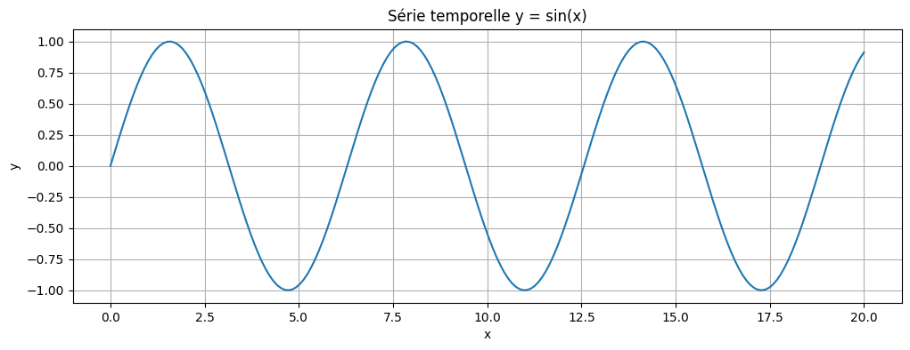
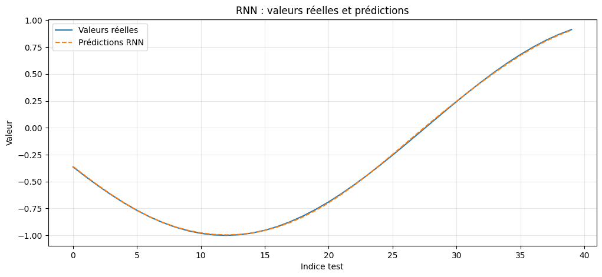
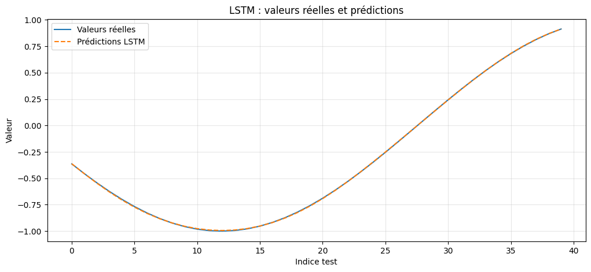
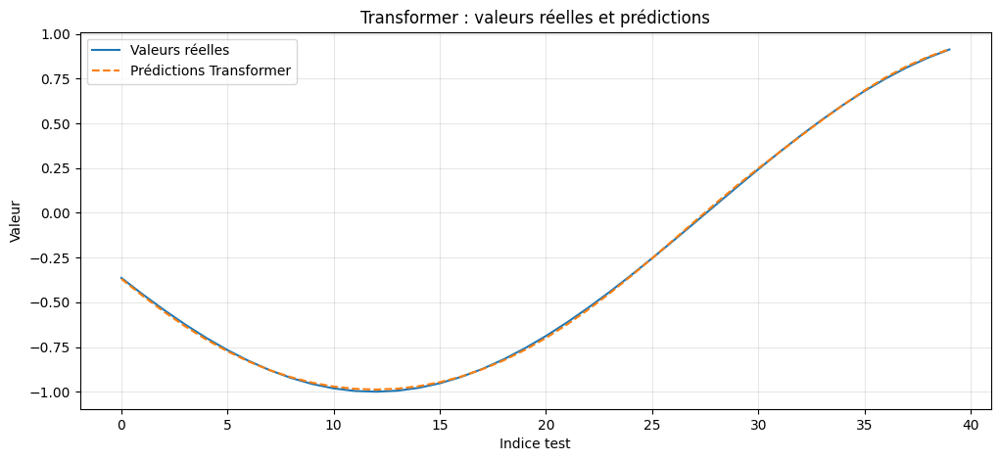
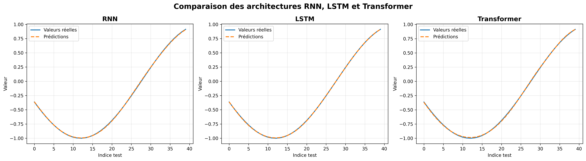

# Première partie — Étude des architectures séquentielles

## 1. Introduction

Cette première partie du TP porte sur l'étude de plusieurs architectures utilisées pour traiter des données séquentielles.

Les expériences réalisées permettent de comprendre les différences entre les réseaux récurrents, les réseaux LSTM et les Transformers, puis de découvrir deux modèles de langage préentraînés : GPT-2 et BERT.

Les expérimentations sont réalisées avec Python et PyTorch, tandis que les modèles préentraînés sont chargés à l'aide de la bibliothèque Hugging Face Transformers.

---

## 2. Génération et préparation de la série temporelle

### Objectif

Créer une série temporelle synthétique afin d'étudier la capacité des modèles à prédire la valeur suivante à partir des observations précédentes.

### Construction des données

La série est construite à partir de la fonction :

\[
y = \sin(x)
\]

Les paramètres utilisés sont :

| Paramètre | Valeur |
|---|---:|
| Nombre de points | 200 |
| Intervalle | [0, 20] |
| Longueur d'une séquence | 10 |
| Exemples d'entraînement | 150 |
| Exemples de test | 40 |

Chaque entrée contient 10 observations consécutives et la cible correspond à la valeur immédiatement suivante.

Les données sont ensuite séparées chronologiquement en ensembles d'entraînement et de test.

### Visualisation

---

## 3. Architecture RNN

### Objectif

Implémenter un réseau de neurones récurrent capable d'apprendre les dépendances temporelles d'une séquence.

### Architecture utilisée

Le modèle SimpleRNN comprend :

- Une couche RNN avec une entrée de dimension 1.
- Une dimension cachée de 16.
- Une couche linéaire de sortie de dimension 1.

Le modèle utilise le dernier état de la séquence pour produire la prédiction.

### Entraînement

| Paramètre | Valeur |
|---|---:|
| Fonction de perte | MSELoss |
| Optimiseur | Adam |
| Learning rate | 0.01 |
| Nombre d'époques | 300 |

### Résultats

Le modèle est évalué sur les 40 exemples de test à l'aide de la Mean Squared Error (MSE).

---

## 4. Architecture LSTM

### Objectif

Étudier une architecture récurrente conçue pour mieux gérer les dépendances à long terme.

### Architecture utilisée

Le modèle SimpleLSTM comprend :

- Une couche LSTM avec une entrée de dimension 1.
- Une dimension cachée de 16.
- Une seule couche récurrente.
- Une couche linéaire de sortie.

Le dernier état de la séquence est utilisé pour effectuer la prédiction.

### Entraînement

| Paramètre | Valeur |
|---|---:|
| Fonction de perte | MSELoss |
| Optimiseur | Adam |
| Learning rate | 0.01 |
| Nombre d'époques | 300 |

### Résultats

Les prédictions sont comparées aux valeurs réelles sur le jeu de test.

---

## 5. Architecture Mini-Transformer

### Objectif

Implémenter un Transformer simplifié pour prédire la valeur suivante d'une séquence temporelle.

### Architecture utilisée

Le modèle MiniTransformer comprend :

1. Une projection linéaire des valeurs d'entrée vers une dimension de 16.
2. Un encodage positionnel appris à l'aide d'une couche Embedding.
3. Un Transformer Encoder composé d'une couche.
4. Un mécanisme d'attention multi-têtes avec deux têtes.
5. Un réseau feed-forward de dimension 32.
6. Une couche linéaire de sortie.

La représentation correspondant à la dernière position est utilisée pour produire la prédiction.

### Entraînement

| Paramètre | Valeur |
|---|---:|
| Dimension du modèle | 16 |
| Nombre de têtes | 2 |
| Nombre de couches Encoder | 1 |
| Dimension Feed-forward | 32 |
| Fonction de perte | MSELoss |
| Optimiseur | Adam |
| Learning rate | 0.01 |
| Nombre d'époques | 300 |

### Résultats

---

## 6. Comparaison des architectures

Les trois architectures sont évaluées sur le même ensemble de test.

La métrique utilisée est la Mean Squared Error :

\[
MSE = \frac{1}{n}\sum_{i=1}^{n}(y_i-\hat{y}_i)^2
\]

Une MSE plus faible indique une erreur quadratique moyenne plus faible sur les observations évaluées.

### Comparaison visuelle

Les résultats numériques exacts sont affichés dans le notebook après l'évaluation des trois modèles.

Cette comparaison permet d'étudier leur capacité respective à apprendre la structure de la série temporelle sinusoïdale.

---

## 7. GPT-2 — Génération de texte

### Objectif

Découvrir le fonctionnement d'un modèle de langage autorégressif préentraîné à travers GPT-2.

### Modèle utilisé

Le modèle chargé depuis Hugging Face est :

`gpt2`

Il est associé à son tokenizer afin de transformer le texte en tokens compréhensibles par le modèle.

### Expérimentation

Le texte initial utilisé est :

`Artificial intelligence can help people`

Le modèle génère ensuite jusqu'à 50 nouveaux tokens.

Paramètres de génération :

| Paramètre | Valeur |
|---|---:|
| Nombre maximal de nouveaux tokens | 50 |
| Sampling | Activé |
| Temperature | 0.8 |
| Top-p | 0.9 |

### Principe

GPT-2 prédit les tokens suivants à partir des tokens précédents. Il utilise donc une approche autorégressive.

### Interprétation

Cette expérimentation illustre comment un modèle préentraîné peut produire une continuation de texte à partir d'une phrase initiale, sans entraînement supplémentaire dans ce notebook.

Le modèle nécessite un accès Internet lors du premier téléchargement de ses poids et de son tokenizer.

---

## 8. BERT — Prédiction d'un mot masqué

### Objectif

Découvrir le fonctionnement d'un modèle bidirectionnel à travers une tâche de prédiction de mot masqué.

### Modèle utilisé

Le modèle chargé depuis Hugging Face est :

`bert-base-multilingual-cased`

Il est associé à un tokenizer multilingue et à une tête de prédiction de type Masked Language Modeling.

### Expérimentation

La phrase utilisée est :

`Paris est la [MASK] de la France.`

Le modèle calcule les probabilités associées aux tokens possibles à la position masquée, puis affiche les cinq propositions les plus probables.

### Principe

Contrairement à GPT-2, BERT exploite le contexte situé à gauche et à droite du token masqué.

Il apprend ainsi à reconstruire des éléments manquants à partir du contexte bidirectionnel.

### Interprétation

Cette expérimentation montre comment BERT peut identifier un mot pertinent dans une phrase en tenant compte de son contexte global.

Le modèle et son tokenizer sont téléchargés depuis Hugging Face lors du premier lancement.

---

## 9. Synthèse de la première partie

| Architecture | Type de tâche | Principe |
|---|---|---|
| RNN | Prédiction temporelle | Traitement récurrent |
| LSTM | Prédiction temporelle | Mémoire et mécanismes de portes |
| Transformer | Prédiction temporelle | Attention multi-têtes |
| GPT-2 | Génération de texte | Prédiction autorégressive |
| BERT | Prédiction de mots masqués | Contexte bidirectionnel |

Cette première partie permet de comprendre les principales différences entre les architectures séquentielles et d'introduire les mécanismes utilisés dans les modèles modernes de traitement du langage naturel.

Elle constitue la base théorique et expérimentale des trois exercices développés dans la deuxième partie du TP.